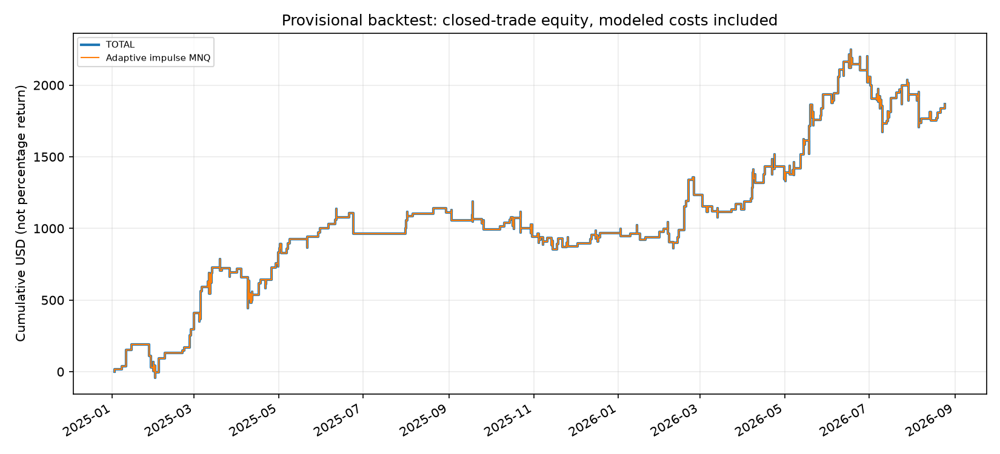

# Adaptive futures exits

Can a causal ATR-regime learner improve fixed TP/SL exits without using future outcomes?

## Entry model
MNQ non-overlapping tick-range bars: high-low ≥40 points and absolute body/range ≥0.75. Continue the bar direction between 15:30 and 22:00 Europe/Rome. ADX14 on the last completed minute in [30,35); completed-minute session range in [239,407] points. These thresholds were researched on historical data; they are not proven universal.

## Adaptive exits
ATR14 regimes use eligible-signal samples in the preceding 90 calendar days (minimum 20 samples; otherwise NORMAL). Candidate grids:
- LOW: (TP,SL) = (5,15), (10,15), (10,20), (10,30), (15,20), (15,30).
- NORMAL: (10,20), (10,30), (15,25), (15,30), (15,40), (20,30), (20,40).
- HIGH: (10,30), (15,30), (15,40), (20,30), (20,40), (20,45), (25,40), (25,45).

Score = mean net points − 0.5 × standard error, minimum eight executed same-regime historical setups. Only candidate outcomes that finished **before** the current decision can be used. Ties prefer smaller stops then larger targets; fallback TP10/SL30. One position at a time: changing exits can change which future signals are executable.

## Historical findings — provisional, one MNQ
| Period | Trades | WR | PF | Net USD | Trade-equity max DD USD |
|---|---:|---:|---:|---:|---:|
| 2025 development/validation | 211 | 75.36% | 1.311 | 967.50 | 342 |
| 2026 available subset | 200 | 72.00% | 1.254 | 900.00 | 576 |

The adaptive version increased PnL but **did not improve every metric**: the fixed baseline had higher win rate/PF and lower drawdown in both samples. Original reported active-day Sharpe is not promoted as a full-calendar annualized Sharpe. Costs model $1 round trip per contract = 0.5 MNQ points. Real execution can be worse.

## Reproduce
```bash
python -m pip install -r requirements.txt
python report.py
python -m unittest discover -s tests -v
```
`learner.py` is an independently packaged causal selector with synthetic unit tests. `data/trades.csv` contains sanitized actual research outcomes; `report.py` rebuilds equity, monthly results and metrics. It does not rerun raw-tick entries. Historical entry/exit implementations are in `archive/`.

## Evidence, not performance promises


See [recomputed year split](reports/by_year.csv) and [dataset/execution assumptions](docs/reproduction.md).

See [data provenance and limitations](docs/provenance.md). Results are backtests, not audited live returns. The public runnable commands reproduce derived-output analytics or synthetic checks, not the entire licensed-data research process.
